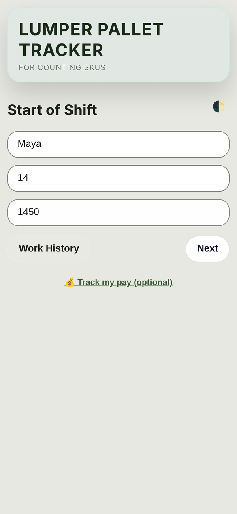
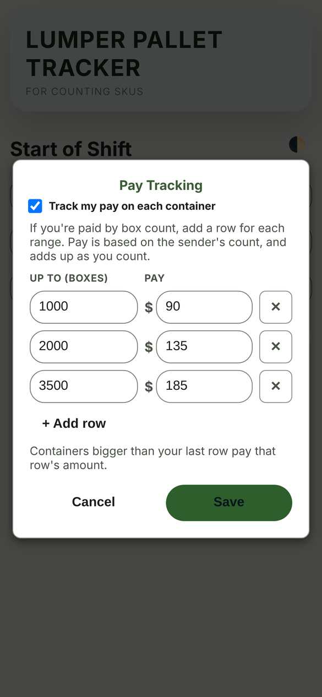
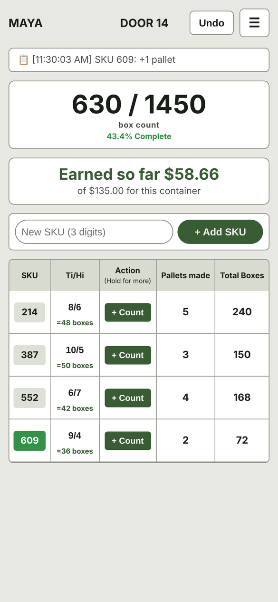
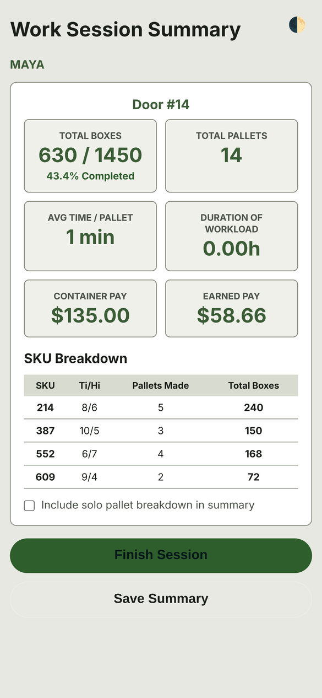

# Lumper Pallet Tracker (LPT)

**Try it:** https://bjessief-apps.github.io/LPT/ (works best on a phone)

This was my first real app. I built it back when I was a lumper and we got paid by the box. I wanted to know exactly where I stood on a trailer, how many boxes were left and what I'd made so far, without doing the math in my head while I worked. Pay tracking is optional and works with any pay scale, so it fits however your company pays. You punch in the SKUs, set the Ti/Hi, and tap every time you finish a pallet.

<table>
  <tr>
    <td align="center"> Start of shift</td>
    <td align="center"> Optional pay table</td>
    <td align="center"> Live count</td>
    <td align="center"> End of session</td>
  </tr>
</table>

Screenshots use made-up sample names and numbers.

## What it does

- Starts a work session with optional worker name, door number, and sender's box count.
- Lets you add 3-digit SKUs and track counts per SKU.
- Supports:
  - full pallet counts (`+1 pallet`)
  - unique/partial pallet counts (custom Ti/Hi)
  - loose box adds
- Shows running totals and completion percentage when sender's count is provided.
- Optional pay tracking: if you're paid by box count, set up your own pay table ("up to 1,000 boxes pays $90", and so on) and watch your pay add up as you count. Leave it off if you don't need it.
- Keeps an activity log and supports undo for the latest action.
- Generates printable summaries and activity logs.
- Stores work history locally in the browser.

## Access

This app is published and accessible through GitHub Pages on your GitHub.io site.

## How it works

The app is a single-page frontend (HTML/CSS/vanilla JS modules) with no backend.

1. **Start screen (`trailer-section`)**
   - Enter name/door/sender's count or skip.
   - Can open **Work History**.
2. **SKU setup (`setup-section`)**
   - Add SKUs before counting.
3. **Live tracker (`tracking-section`)**
   - Set Ti/Hi for each SKU.
   - Tap `+ Count` for a full pallet.
   - Long-press `+ Count` for partial pallet / loose boxes.
   - Long-press SKU to rename/delete.
   - Long-press pallet count to view SKU event history.
4. **Signout summary (`signout-section`)**
   - Final totals, duration, payout, and SKU breakdown.
   - Export summary.
5. **History (`history-section`)**
   - View, filter, export, and delete saved past sessions.

